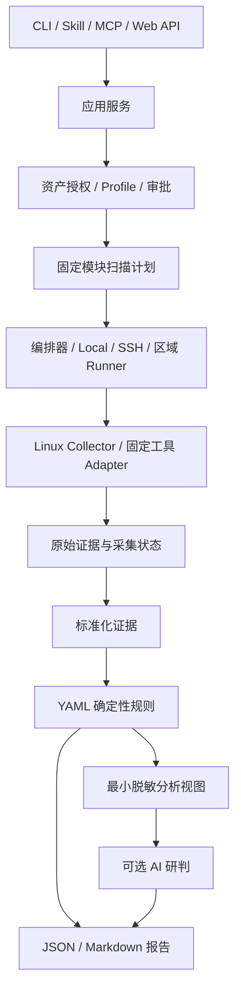

# 系统架构

版本：设计基线 0.1，2026-11-20。文档交付为 IMPLEMENTED；采集、扫描、证据存储、规则、AI、MCP、Runner、Web 的运行能力为 PLANNED。本轮首切片仅是离线 CLI，具体实现与新鲜执行证据以本轮执行报告为准。

## 1. 分层和依赖方向

入口只负责请求转换、身份上下文和结果展示，不持有检测逻辑。应用层依赖领域模型与窄接口；Linux 实现、SSH、数据库和模型 Provider 依赖这些契约。Skill 不写扫描脚本；MCP/Web 不能绕过同一个授权与计划服务。AI 无执行器、无凭据和规则变更权限。

## 2. 模块边界

| 模块 | 输入 → 输出 | 关键边界 |
|---|---|---|
| asset | YAML/JSON → 校验资产快照 | host_id 稳定；配置不是平台 RBAC 的替代 |
| policy / planner | 资产、目标、Profile → 离线计划 | 所有目标授权成功后才返回计划；不联网 |
| authorization / approval | 当前主体、计划摘要、审批记录 → allow/deny | 执行前复核；深扫不可仅凭非空 ID 放行 |
| orchestrator | 已授权执行计划 → ScanJob / attempts | 独立模块时限、取消、并发、资源预算 |
| collector/linux | 固定模块请求 → ModuleResult | 不接收命令字符串，不主动探测其他 IP |
| tools | 固定工具操作 → ToolResult | 固定路径/参数白名单；输出仍是不可信证据 |
| evidence / normalize | 原始字节 → 元数据与版本化记录 | 原始、标准化、AI 视图分开，不覆盖历史 |
| rules | 证据快照、可信基线 → RuleResult / Finding | PASS/FAIL/UNKNOWN/NOT_APPLICABLE；每个 Finding 必须有证据 |
| analyzer | 最小脱敏视图 → 已验证 Assessment | 默认关闭；不修改规则严重度，不自动处置 |
| report | 任务、证据、规则、可选研判 → JSON/Markdown | 模块缺失、盲区和人工复核状态必显 |
| storage / audit | 版本化实体与事件 → 只追加历史 | SQLite/文件首期，平台 PostgreSQL/对象存储后续 |

## 3. 工程布局

权威目录契约见 [REPOSITORY-LAYOUT](REPOSITORY-LAYOUT.md)，backend为Go module根，frontend为未来独立TS工程，integrations负责产品Agent接入材料；根目录仅跨工程资源和构建调度。各可执行程序独立入口，共用internal内核。

当前首切片契约为 `backend/cmd/hostsec`、`backend/internal/cli`、`backend/internal/asset`、`backend/internal/policy`、`backend/internal/planner`、`schemas/`、`examples/`、`testdata/`。后续按任务实际落地 `backend/internal/collector/linux`、`transport`、`tools`、`evidence`、`rules`、`analyzer`、`report`、`storage`、`audit`，不建立无运行行为的空模块或 Windows 假实现。

本轮 [CLI-SDD](../03-sdd/CLI-SDD.md) 的 Go 1.27.3、标准库 flag、严格资产 v1 和四 Profile 为首切片契约。设计草案中的 Go 类型、表名、协议均不是已经存在的代码。

## 4. 部署和信任拓扑

首期控制端在明确授权网络内运行 CLI。后续本机 Collector 在 Linux 工作；SSH 模式只访问登记目标和已部署固定 Collector，严格验证 host key；连接失败不猜测其他地址。远端安装是独立、人工授权的部署操作，scan 不自行安装。

WP6 以后中央平台只向安全域分发签名任务，Runner 校验安全域、有效期、nonce、主体权限和 Profile，在本区域执行并用出站 mTLS 或签名离线结果包回传。中央平台不跨区域持有全部 SSH 凭据或直连所有主机。平台管理员不天然拥有所有资产读取权；操作与审批分离。

## 5. 运行数据流和一致性

1. 读取资产和策略的固定版本，解析目标，生成计划；计划显示模块、工具、路径、限制、影响和审批要求。
2. 执行前重新检查授权、目标身份、审批绑定和维护窗口；创建 scan_id/attempt_id，不信任客户端提交的 ready 标志。
3. Collector 分模块采集；原始字节先落盘并摘要，标准化后入索引；失败模块同样记录状态和原因。
4. 规则按必需字段与完整性检查后求值，缺证据产生 UNKNOWN，不能生成无支撑的风险结论。
5. 先完成确定性结果；仅在启用与外发授权满足时构造最小视图调用 AI，失败不阻止规则报告。
6. 报告固定输入快照，列出实际运行工具、覆盖分母、证据索引、盲区与复核状态。后续整改只记录人工流程，不由扫描引擎处置。

原始证据不可因脱敏而覆盖；规则使用标准化证据，AI 使用单独视图。跨模块关联必须同一 host_id/scan_id，跨扫描历史比较显式记录 baseline_scan_id 和基线审批版本。

## 6. 分期与退出门禁

MVP-1 完成 CLI/资产/计划；MVP-2 完成 Linux 采集；MVP-3 完成九条最低规则；MVP-4 完成证据与报告；MVP-5 完成可选研判；MVP-6 完成经测试的 Agent 接入。六项全部验收后才可称首期 MVP 交付。工具 Adapter 按 WP4 逐个验收，不把缺工具视为未发现恶意文件。MCP/Runner 为 WP6，Web 为 WP7。

每个阶段必须经过需求、设计、实现、自测、独立审计、验收；编译与交叉编译不代表 Linux 双架构运行验收。真实 VM/容器上的 CPU、RSS、IO、权限与证据核对是 Collector/工具放行门禁。环境和生产授权未提供时可以推进离线工程，但真实主机验收仍为 BLOCKED。

## 7. 架构能力限制

快照不能替代持续 EDR；内核失陷会污染系统提供的数据，SHA-256 只能检测已固定对象的变化，不能证明主机输出真实。隐藏进程/rootkit 检查只能报告交叉视图异常与盲区。未命中规则不能表述主机绝对安全。数据库、历史、断点恢复和限额执行未实现前，CLI 不能宣称已有这些能力。
