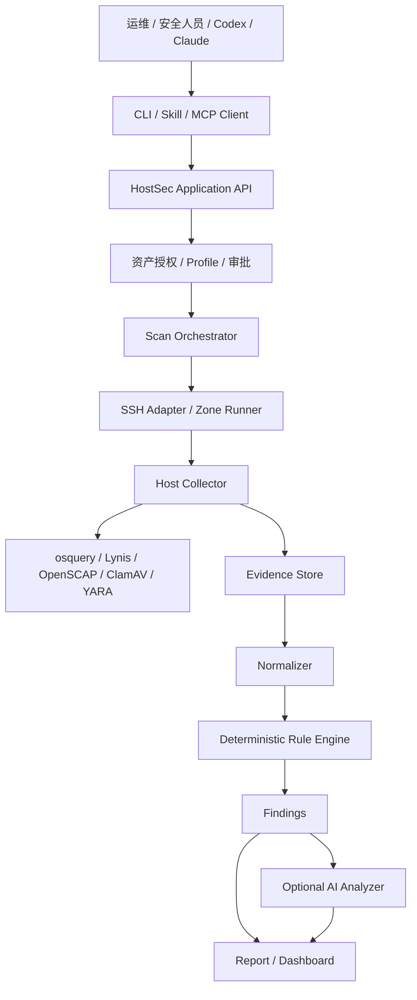
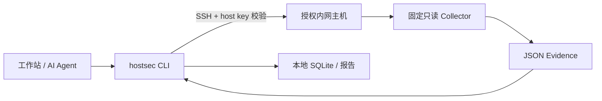
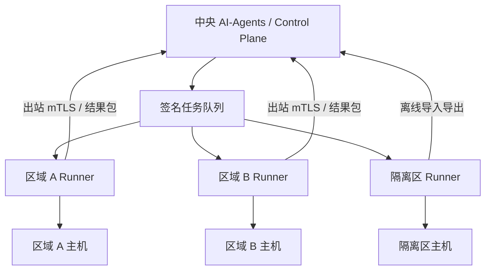

# 02. 技术架构设计

## 1. 总体架构



## 2. 分层设计

### 接入层
- `hostsec` CLI：第一阶段本地入口。
- Codex / Claude Skill：复用流程，不直接执行任意命令。
- MCP Server：向 Agent 提供受控工具。
- Web API / UI：后续接入。

### 应用服务层
- Asset Service：资产、分组、授权范围。
- Scan Planner：扫描计划和影响预估。
- Authorization Service：目标、Profile、审批校验。
- Orchestrator：任务状态机、并发、超时。
- Evidence Service：证据存储、哈希、完整性清单。
- Rule Service：规则加载、执行、例外。
- AI Analysis Service：脱敏、模型调用、结构化校验。
- Report Service：报告和历史差异。

### 执行层
- SSH Adapter：固定 Collector 入口，严格 host key 验证。
- Local Adapter：本机执行。
- Zone Runner：隔离区域内拉取签名任务。
- Host Collector：采集主机状态并输出 JSON。
- Tool Adapter：包装专业工具。

### 数据层
MVP：SQLite + 本地证据目录。
平台化：PostgreSQL + MinIO / S3 兼容对象存储。
可选：OpenSearch（大规模检索）、ClickHouse（大规模历史指标）。
不建议首期引入 Kafka、Redis、Kubernetes 等基础设施，除非规模和可靠性要求已经证明其必要性。

## 3. 执行拓扑

### CLI 直连模式


约束：
- 控制端必须在授权网络内。
- 目标必须在资产清单登记。
- 使用专用巡检账号，不使用 root 直接登录。
- 必要特权通过固定 root-owned Collector 入口提供。
- 不开放通用 `exec` 参数。

### 多安全域 Runner 模式

中央平台不直接跨区 SSH。Runner 只接受签名任务，校验任务签名、有效期、nonce、目标范围和 Profile。区域之间不共享凭据。结果回传前执行本地脱敏。

## 4. 技术栈

| 层 | 建议 |
|---|---|
| CLI / Collector / API / MCP | Go |
| 远程执行 | OpenSSH 优先；后续可选 Go SSH |
| 主机数据 | 自研 Collector + osquery |
| 安全检测 | ClamAV、YARA、OpenSCAP、Lynis |
| 规则 | YAML + Go 规则引擎 |
| 本地存储 | SQLite + 文件系统 |
| 平台存储 | PostgreSQL + MinIO |
| AI | OpenAI-compatible Provider + 本地模型 |
| 工作流 | 首期确定性状态机；复杂人工审批再评估 LangGraph |
| 前端 | 第二阶段以后 React + TypeScript |
| 可观测 | OpenTelemetry + 结构化日志 |

## 5. 安全设计
- 固定可执行文件和参数数组，禁止 Shell 字符串拼接。
- SSH 严格验证 known_hosts，禁止关闭主机指纹校验。
- Collector 和配置由 root 拥有，普通巡检账号不可修改。
- 不提供任意 sudo，不允许模型生成命令。
- 结果包含 SHA-256、Collector / Rule / Policy 版本。
- AI 只读取脱敏分析视图，不读取凭据和原始环境变量。
- 主机输出和日志均视为不可信输入，防范 Prompt Injection。
- 记录模型 Provider、Model、Prompt Version 和输入输出摘要哈希。

## 6. 插拔点
```text
Collector: Linux / Windows / Container
Transport: Local / OpenSSH / ZoneRunner / OfflineBundle
Tools: osquery / ClamAV / YARA / OpenSCAP / Lynis / Velociraptor
Analyzer: OpenAI / OpenAI-compatible / Local / Mock
Storage: SQLite / PostgreSQL / Object Storage
```

## 7. 架构取舍
先把采集、证据、规则、报告和安全边界做正确，再按主机规模扩展。不要第一阶段就部署完整 SIEM 集群和多 Agent 系统。
