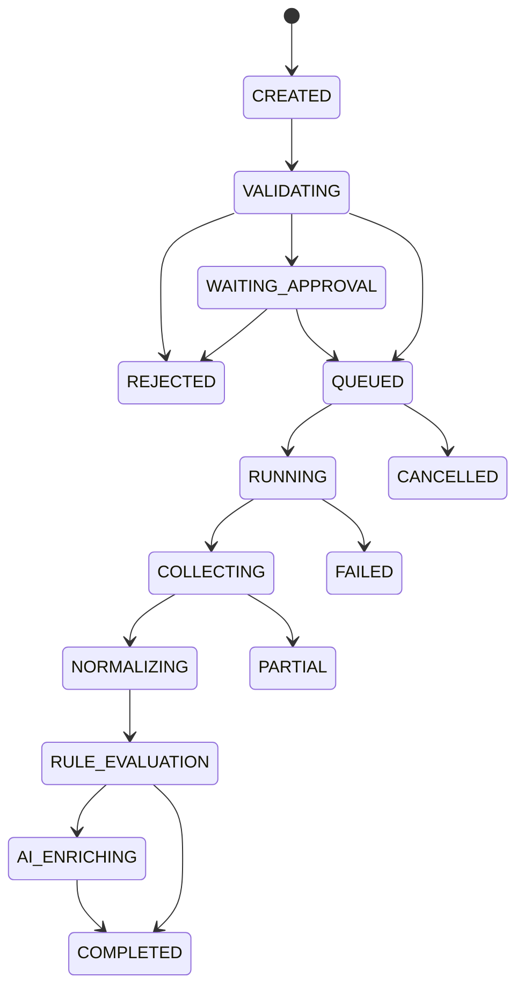

# 03. 软件详细设计（SDD）

## 1. 模块划分

| 模块 | 职责 |
|---|---|
| Asset Registry | 主机资产、标签、授权范围 |
| Policy Manager | Profile、规则和例外 |
| Scan Planner | 生成计划和影响说明 |
| Authorization | 目标授权和审批校验 |
| Orchestrator | 任务状态机、并发、超时、取消 |
| Transport | Local / SSH / Runner / Offline |
| Collector | 主机状态采集 |
| Tool Adapters | 专业工具封装 |
| Normalizer | 标准化证据字段 |
| Rule Engine | 确定性检测 |
| Evidence Service | 原始证据、哈希和 manifest |
| AI Analyzer | 脱敏、模型调用、结构化校验 |
| Report Service | JSON / Markdown / HTML 报告 |
| Audit | 关键操作留痕 |

## 2. 核心领域模型

### Host
`host_id`、hostname、addresses、platform、distribution、os_version、architecture、zone、environment、business_system、owner、criticality、authorized、allowed_profiles、labels。

### ScanJob
`scan_id`、requester、approval_id、host_ids、profile、policy_version、collector_version、rule_bundle_version、status、created_at、started_at、completed_at、summary、failure_reason。

### Evidence
`evidence_id`、scan_id、host_id、category、source_type、collector_name、collector_version、command_id、started_at、completed_at、exit_code、collection_status、raw_object_uri、normalized_object_uri、sha256、redaction_status、completeness、warnings。

### Finding
`finding_id`、scan_id、host_id、rule_id、category、severity、confidence、title、description、evidence_refs、rule_rationale、ai_assessment_id、status、first_seen_at、last_seen_at、owner、remediation_guidance、requires_human_review。

### AI Assessment
`assessment_id`、finding_ids、provider、model、prompt_version、input_evidence_ids、input_hash、output_json、output_hash、confidence、limitations、created_at。

## 3. 任务状态机



规则：
- AI 阶段失败不影响确定性报告；记录 `ai_status=failed`。
- 必需模块缺失时为 PARTIAL / UNKNOWN，不得伪装 PASS。
- 取消后停止后续模块，已采集证据保留。
- 重试生成新的 attempt_id，不覆盖历史证据。

## 4. Profile

| Profile | 范围 | 适用 | 风险 |
|---|---|---|---|
| quick | 身份、进程、网络、账号、服务、自启动、关键配置 | 快速检查 | 低 |
| standard | quick + 软件包漏洞匹配、基线、指定目录扫描 | 周期巡检 | 中 |
| deep | standard + 扩展文件扫描、YARA、完整性和日志 | 维护窗口 | 中高 |
| incident-response | 定向易失信息、文件和日志取证 | 安全事件 | 高敏感，必须审批 |

## 5. 命令执行模型

禁止设计 `exec(command:string)`、`shell(command:string)`、`ssh_exec(host, command:string)`。

只提供：
```text
scan_host(host_id, profile, approval_id?)
get_scan(scan_id)
get_findings(scan_id)
get_evidence(evidence_id)
generate_report(scan_id, format)
```

远端固定入口示例：
```text
/usr/local/libexec/hostsec-collector scan --profile quick --format json
```
二进制 root-owned、普通账号不可写；参数只允许枚举值；路径来自已签名策略；内部命令表固定。

SSH：
- 严格 known_hosts / host key 校验。
- 优先 SSH Agent 或密钥管理服务。
- 不在 YAML、日志或命令行保存密码和私钥。
- 使用专用巡检账号，禁止 root 直接登录。

## 6. 规则引擎

规则示例：
```yaml
id: PROC-001
version: 1
title: 进程可执行文件不存在
category: process_anomaly
severity: high
platforms: [linux]
profiles: [quick, standard, deep]
evidence_required: [process_inventory]
logic:
  type: field_condition
  field: process.exe_exists
  operator: equals
  value: false
confidence: 70
false_positive_notes:
  - 进程启动后原始文件被合法升级或删除
recommendation:
  - 核实进程归属和父进程
  - 关联网络连接和启动项证据
```

规则要求：
- 规则与程序分离、静态校验。
- 每条规则有正例、反例和边界测试。
- 规则版本写入报告。
- 规则不执行修复动作。
- 规则严重度与 AI 建议优先级分开。

## 7. 风险表达
分别展示：
- severity：规则定义的技术严重度。
- confidence：证据支持程度。
- asset_criticality：主机业务重要级别。
- exposure：暴露面和可达性。
- priority：调查排序。

AI 可以建议调查优先级，不得覆盖原始规则严重度。单一异常不应直接判定为木马。

## 8. 存储
逻辑表：`hosts`、`host_labels`、`scan_jobs`、`scan_attempts`、`approvals`、`evidence`、`findings`、`finding_evidence`、`rules`、`rule_bundles`、`ai_assessments`、`exceptions`、`audit_events`、`model_usage`。

原始大文件存对象存储，数据库只保存元数据和 URI。证据对象只追加，不覆盖。

## 9. API 草案

| 方法 | 路径 | 用途 |
|---|---|---|
| POST | `/api/v1/scans/plan` | dry-run 计划 |
| POST | `/api/v1/scans` | 创建扫描 |
| GET | `/api/v1/scans/{scan_id}` | 查询状态 |
| POST | `/api/v1/scans/{scan_id}/cancel` | 取消任务 |
| GET | `/api/v1/hosts` | 授权主机 |
| GET | `/api/v1/findings` | 发现项 |
| GET | `/api/v1/evidence/{evidence_id}` | 证据元数据 |
| POST | `/api/v1/scans/{scan_id}/analyze` | AI 研判 |
| GET | `/api/v1/reports/{scan_id}` | 报告 |
| POST | `/api/v1/approvals` | 审批 |

不得提供任意命令执行、文件删除或进程终止接口。

## 10. 错误码
`AUTH_DENIED`、`HOST_NOT_AUTHORIZED`、`HOST_KEY_MISMATCH`、`CONNECT_TIMEOUT`、`COMMAND_TIMEOUT`、`PERMISSION_INSUFFICIENT`、`TOOL_NOT_INSTALLED`、`COLLECTION_PARTIAL`、`EVIDENCE_HASH_FAILED`、`SCHEMA_VALIDATION_FAILED`、`AI_PROVIDER_ERROR`、`APPROVAL_REQUIRED`。

错误信息不得回显密钥、环境变量或完整敏感命令行。
