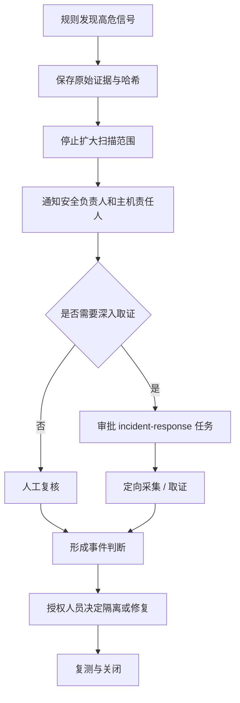

# 07. 安全边界、威胁模型与应急响应

## 1. 默认 READ_ONLY

允许：读取系统信息、进程、网络状态、服务、用户、配置、指定日志和文件元数据；对授权文件计算哈希；运行批准的只读扫描器。

禁止：杀进程、删除或隔离文件、修改防火墙/路由/账号/SSH/服务/系统配置、安装卸载软件、修改启动项、执行任意 Shell、扫描未授权网段、自动上传文件样本、自动封禁 IP 或隔离主机。

## 2. 权限模型
普通巡检账号负责连接和发起固定 Collector；必要特权通过固定 root-owned Collector 入口提供。Collector：
- 安装在受控目录，由 root 拥有，普通账号不可修改。
- 只接受枚举 Profile 和经过校验的参数。
- 不支持用户传入任意命令、脚本或任意路径。
- 每个模块有固定超时和资源限制。
- sudoers 必须经安全评审，禁止 `NOPASSWD: ALL`。

## 3. SSH 安全
- 严格校验 known_hosts / host key。
- 禁止 `StrictHostKeyChecking=no`。
- 不把密码写入 YAML 或命令行。
- 使用专用巡检账号和独立密钥。
- 优先经堡垒机或 ProxyJump。
- 限制来源和目标主机范围。
- 定期轮换密钥并审计登录。
- 网络不可达时失败，不尝试扫描其他地址。

## 4. 性能保护
- 设置最大并发、连接超时、命令超时。
- 文件扫描限制最大文件数、大小、递归深度和总时长。
- 排除网络挂载、数据库数据目录、备份目录和高 IO 路径，除非审批。
- deep 扫描安排维护窗口。
- 设置 CPU / IO 阈值，超过阈值暂停或终止。
- 生产先单台试点，再扩大范围。
- 默认不启用 ClamAV 自动删除或隔离。

## 5. 威胁模型

| 威胁 | 控制 |
|---|---|
| Agent 生成危险命令 | 不提供任意 Shell，只暴露固定动作 |
| 恶意主机输出 Prompt Injection | 所有主机数据视为不可信证据 |
| SSH 中间人 | host key pinning |
| 巡检账号泄露 | 最小权限、轮换、登录审计 |
| Collector 被替换 | root-owned、签名发布、版本校验 |
| 结果包被篡改 | SHA-256 manifest、签名、导入校验 |
| 模型数据外泄 | 字段脱敏、最小化、外发审批 |
| 恶意规则包 | 审查、测试、签名和灰度 |
| 扫描导致 IO 峰值 | 限速、维护窗口、资源阈值 |
| 误报导致误处置 | 不自动处置，人工复核 |

## 6. 高危异常流程

平台不代替企业事件响应制度。是否隔离、断网或停服务，由授权安全和业务负责人按应急预案决定。

## 7. 证据保管链
保存原始证据和采集时间；记录 Collector、规则和执行节点版本；计算 SHA-256；证据对象只追加不覆盖；人工导出和查看留审计；留存周期由公司数据治理制度确定。事件调查启用独立证据目录和审批记录。

## 8. 外部模型边界
未脱敏原始日志、进程命令行、环境变量不得直接外发；不默认上传文件样本至在线多引擎扫描服务；任何第三方服务先确认数据处理和留存政策；模型返回高风险不能自动触发处置。
